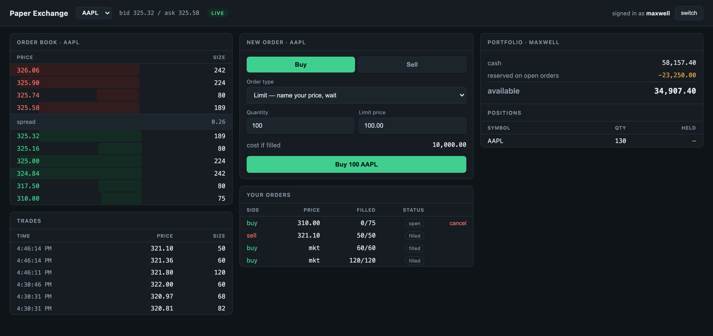

# Paper Exchange

A trading exchange you can actually place orders on. It has a real matching
engine, accounts with cash that can run out, and an order book that updates live
in the browser.



Most trading projects I looked at are a price chart with a buy button. I wanted
to build the part underneath: the thing that decides who trades with whom, at
what price, and in what order, and then makes sure the money moves correctly.

## How it works

```
browser ──HTTP──▶ FastAPI ──▶ Exchange ──▶ Postgres   (accounts, cash, history)
   ▲                             │
   └────WebSocket────────────────┘└──▶ Order book   (open orders, in memory)
```

The order book holds open orders and does the matching. Postgres holds accounts,
cash, positions, and every trade that has happened. The book is rebuilt from
Postgres on startup, so the database is the source of truth and the book is
really just a cache.

| File | What's in it |
|---|---|
| [`orderbook.py`](backend/app/orderbook.py) | The matching engine. Standard library only. |
| [`exchange.py`](backend/app/exchange.py) | Accounts and money. Check, reserve, settle. |
| [`models.py`](backend/app/models.py) | Postgres tables. |
| [`main.py`](backend/app/main.py) | HTTP endpoints and the WebSocket. |
| [`marketmaker.py`](backend/app/marketmaker.py) | Bot that quotes both sides so there's always liquidity. |
| [`frontend/src`](frontend/src) | React app. |

43 tests, about 1,500 lines of Python and 800 of TypeScript.

## Matching rules

Orders match on price-time priority. Better prices go first, and among equal
prices whoever got there first goes first.

Trades happen at the price of the order that was already resting on the book,
not the one that just arrived. If you're bidding 100 and I come in willing to
sell at 99, we trade at 100. You were there first, so you get what you asked
for, and I get the better price for crossing the spread. This flips depending on
who arrived first, which is easy to get backwards, so it's tested both ways.

## Money

Every amount is stored as a whole number of cents. Floats can't represent 0.10
exactly, and in something that adds up money all day those errors eventually
stop balances from reconciling. `to_cents()` throws if you hand it a float,
since by then the precision is already gone. Prices go over the API as strings
like `"99.50"` for the same reason, because JSON numbers are floats.

Placing an order doesn't move money, but it does reserve it:

```
available cash  = cash_cents - reserved_cents
sellable shares = quantity  - reserved_quantity
```

Otherwise you could place ten orders for $10,000 each with $10,000 in your
account. Every open order holds a reservation until it fills or gets cancelled.

The UI greys out the Sell button if you own nothing, but that's just to be
helpful. All the actual checks are on the server, and skipping the UI with curl
gets you the same rejection.

## The market maker

A matching engine needs two sides. If you're the only person using it, your
order sits there forever and nothing ever fills.

So there's a bot quoting four bids and four asks around a mid price, requoting
every three seconds. It pulls real prices from yfinance once when the server
starts and random walks from there. It doesn't stream live prices on purpose,
since markets close and APIs rate limit, and I didn't want a demo that only
works on a Tuesday afternoon.

## Things that broke

**Money overflowed the column.** The server crashed on startup with
`NumericValueOutOfRange` when I funded the market maker with $100,000,000. In
cents that's 10 billion, and Postgres `INTEGER` stops at 2,147,483,647. Storing
money as cents means a 32-bit column caps out around $21.4 million, and SQLModel
picks `INTEGER` for a plain Python `int` without saying anything. All the cents
columns are `BIGINT` now, with a test that opens a $100M account.

**My typecheck wasn't the real typecheck.** `npx tsc --noEmit` was clean but the
Docker build failed. The build runs `tsc -b`, which uses a different config with
`erasableSyntaxOnly`, and `constructor(readonly status: number)` is
TypeScript-only syntax that can't be erased. I'd been running a command that
didn't match what actually builds.

**I tested the wrong server for ten minutes.** After bringing the containers up,
`curl localhost:8077/health` showed a symbol that only existed in my local dev
database. An old `uvicorn` still had `127.0.0.1:8077` while the container had
`*:8077`, and `localhost` resolved to the local one. Both were running, both
answered, and only one was the thing I meant to test.

**A container that worked but reported unhealthy.** nginx served pages fine on
8080 but its healthcheck kept failing. nginx binds `0.0.0.0:80`, which is IPv4
only, and busybox `wget` resolves `localhost` to `::1` first and gets refused.
The app was never broken, just the check. It matters because compose gates
startup on health, so anything depending on that container would wait forever.

**Tests that only failed together.** A WebSocket test hung for two minutes,
because the event bus binds its loop in FastAPI's lifespan hook and my fixture
skips lifespan, so publishing silently did nothing. Fixing that exposed a second
problem: the bus is a module-level singleton, so once one test ran, every later
test inherited its closed event loop. Now it resets between tests and there's a
15 second timeout.

## Running it

```bash
docker compose up --build
```

Open http://localhost:8080. Any name works, new accounts start with $100,000.
Open a second window with a different name and you can trade against yourself.

Without Docker, if you have Postgres running:

```bash
createdb paper_exchange && createdb paper_exchange_test
cd backend && uv sync && uv run uvicorn app.main:app --port 8077 --reload
cd frontend && npm install && npm run dev
```

Tests:

```bash
cd backend && uv run pytest -q
```

There are also three scripts that print what they're doing and don't need a
server:

```bash
uv run python demo_orderbook.py   # orders filling the book, then a market order hitting it
uv run python demo_exchange.py    # cash and shares moving between two accounts
uv run python demo_restart.py     # killing the book and rebuilding it from Postgres
```

## What it doesn't do

- No short selling. You can't sell what you don't own, which would need margin
  and a borrow.
- Runs on one process. The book is in memory, so this doesn't scale
  horizontally without putting it behind a shared service or splitting by symbol.
- The market maker's price resets when you restart, since the mids only live in
  memory.
- No auth. Accounts are just names.
- Not deployed anywhere. WebSockets need a long-lived process, so serverless
  hosting won't work for it.

## Built with

Python, FastAPI, SQLModel, Postgres, React, TypeScript, Vite, Docker, nginx, pytest.
