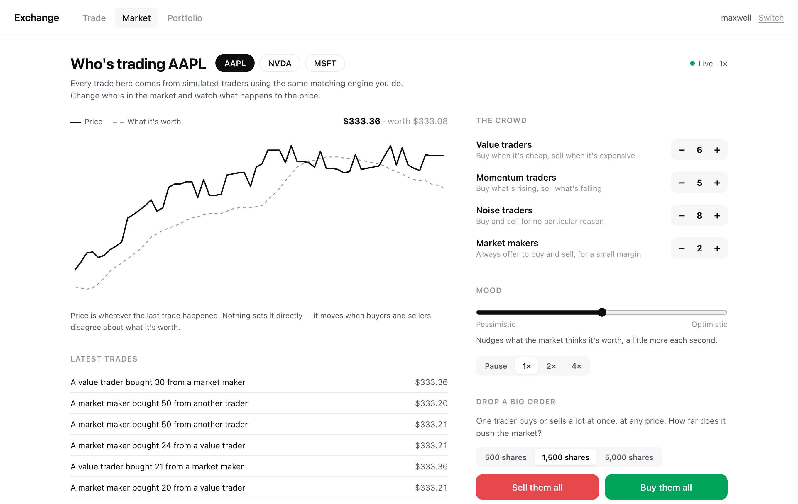

# Stock Simulator

A trading exchange you can place orders on, full of simulated traders
whose orders decide the price. It has a real matching engine, accounts with cash
that can run out, and a sandbox where you change who's in the market and watch
what happens.



Most trading projects I looked at are a price chart with a buy button. I wanted
to build the part underneath: the thing that decides who trades with whom, at
what price, and in what order, and then makes sure the money moves correctly.

## How it works

```
browser ──HTTP──▶ FastAPI ──▶ Exchange ──▶ Postgres   (accounts, cash, history)
   ▲                             │
   └────WebSocket────────────────┘└──▶ Order book   (open orders, in memory)
```

The order book holds open orders and does the matching. Postgres holds accounts,
cash, positions, and every trade that has happened. The book is rebuilt from
Postgres on startup, so the database is the source of truth and the book is
really just a cache.

| File | What's in it |
|---|---|
| [`orderbook.py`](backend/app/orderbook.py) | The matching engine. Standard library only. |
| [`exchange.py`](backend/app/exchange.py) | Accounts and money. Check, reserve, settle. |
| [`models.py`](backend/app/models.py) | Postgres tables. |
| [`main.py`](backend/app/main.py) | HTTP endpoints and the WebSocket. |
| [`agents.py`](backend/app/agents.py) | The four kinds of simulated trader. |
| [`market_sim.py`](backend/app/market_sim.py) | Runs them against the real exchange every second. |
| [`pnl.py`](backend/app/pnl.py) | Profit and loss, from the trade history. |
| [`frontend/src`](frontend/src) | React app. |

64 tests, about 2,400 lines of Python and 1,300 of TypeScript.

## Matching rules

Orders match on price-time priority. Better prices go first, and among equal
prices whoever got there first goes first.

Trades happen at the price of the order that was already resting on the book,
not the one that just arrived. If you're bidding 100 and I come in willing to
sell at 99, we trade at 100. You were there first, so you get what you asked
for, and I get the better price for crossing the spread. This flips depending on
who arrived first, which is easy to get backwards, so it's tested both ways.

## Money

Every amount is stored as a whole number of cents. Floats can't represent 0.10
exactly, and in something that adds up money all day those errors eventually
stop balances from reconciling. `to_cents()` throws if you hand it a float,
since by then the precision is already gone. Prices go over the API as strings
like `"99.50"` for the same reason, because JSON numbers are floats.

Placing an order doesn't move money, but it does reserve it:

```
available cash  = cash_cents - reserved_cents
sellable shares = quantity  - reserved_quantity
```

Otherwise you could place ten orders for $10,000 each with $10,000 in your
account. Every open order holds a reservation until it fills or gets cancelled.

The UI greys out the Sell button if you own nothing, but that's just to be
helpful. All the actual checks are on the server, and skipping the UI with curl
gets you the same rejection.

## The simulated market

A matching engine needs two sides. If you're the only person using it, your order
sits there forever. So the market is full of bots, and they go through exactly
the same `place_order` you do — same checks, same matching, same settlement. If
one can't afford something, it doesn't get it.

There are four kinds:

- **Value traders** each have their own guess at what the stock is worth. They
  buy below it, sell above it, and leave orders waiting where it'd be a bargain.
  They're what keeps the price anchored.
- **Momentum traders** buy what's been rising over the last few seconds and sell
  what's been falling. Each one has a position limit, so a rally runs out of
  buyers eventually instead of going forever.
- **Noise traders** trade for no reason, which is most of what real order flow is.
- **Market makers** quote both sides all the time and lean their quotes against
  whatever they're holding.

Nothing sets the price. It's just wherever the last trade happened. The one
outside input is a "fair value" that drifts slowly and smoothly; only the value
traders can see it, and each sees it a little wrong.

### What changing the crowd does

Averaged over four runs each:

| Crowd | Price movement | Avg gap from fair value | Spread |
|---|---|---|---|
| Default | 1× | 0.22% | 3.4¢ |
| Momentum-heavy | **6.7×** | **1.90%** | 1.5× |
| No market makers | **4.4×** | 0.29% | **2.6×** |
| No value traders | 0.5× | stops tracking it | — |

Pile in momentum traders and you get bubbles that overshoot and come back. Pull
the market makers and the spread more than doubles and the price gets jumpy.
Remove the value traders and nobody knows what the stock is worth anymore, so the
price goes quiet and stops following fair value at all.

The sandbox also has a button that drops one huge market order in. A 500-share
sell fills completely and barely moves the price. A 5,000-share sell only fills
20% of the way before the book runs out of buyers — and a few seconds later the
momentum traders have followed it down.

## Things that broke

**I measured the wrong thing and it looked like a finding.** Testing the big-order
button, more market makers seemed to make the price impact *worse*, consistently
across twelve runs. But with one market maker, only 19% of a 2,500-share order
actually executed — the book ran out and the rest was abandoned. The price barely
moved because most of the order never happened. I was measuring where the last
trade landed instead of how much got done.

**A restart caused a fake crash.** After restarting the server the price fell 2%
below fair value and then jumped 3.5% in one tick. Postgres had restored the bots'
orders from the previous run, but the new bots didn't know those orders existed,
so nothing ever cancelled them. When the near side of the book thinned out, a
market order walked into them at stale prices. On top of that, fair value was
being reseeded from the live stock price while the book was still sitting at the
old one. Now old bot orders get cancelled on startup and the market picks up from
its last trade.

**Market makers were absent from their own market.** Each second, makers pulled
their quotes and then waited in a shuffled line with everyone else to post new
ones. Anyone drawn ahead of them traded against a book with no makers in it. After
a restart the book was completely empty and the first market order fell straight
through. Makers now requote before anyone else acts.

**Money overflowed the column.** The server crashed on startup with
`NumericValueOutOfRange` when I funded the market maker with $100,000,000. In
cents that's 10 billion, and Postgres `INTEGER` stops at 2,147,483,647. Storing
money as cents means a 32-bit column caps out around $21.4 million, and SQLModel
picks `INTEGER` for a plain Python `int` without saying anything. All the cents
columns are `BIGINT` now, with a test that opens a $100M account.

**My typecheck wasn't the real typecheck.** `npx tsc --noEmit` was clean but the
Docker build failed. The build runs `tsc -b`, which uses a different config with
`erasableSyntaxOnly`, and `constructor(readonly status: number)` is
TypeScript-only syntax that can't be erased. I'd been running a command that
didn't match what actually builds.

**I tested the wrong server for ten minutes.** After bringing the containers up,
`curl localhost:8077/health` showed a symbol that only existed in my local dev
database. An old `uvicorn` still had `127.0.0.1:8077` while the container had
`*:8077`, and `localhost` resolved to the local one. Both were running, both
answered, and only one was the thing I meant to test.

**A container that worked but reported unhealthy.** nginx served pages fine on
8080 but its healthcheck kept failing. nginx binds `0.0.0.0:80`, which is IPv4
only, and busybox `wget` resolves `localhost` to `::1` first and gets refused.
The app was never broken, just the check. It matters because compose gates
startup on health, so anything depending on that container would wait forever.

**Tests that only failed together.** A WebSocket test hung for two minutes,
because the event bus binds its loop in FastAPI's lifespan hook and my fixture
skips lifespan, so publishing silently did nothing. Fixing that exposed a second
problem: the bus is a module-level singleton, so once one test ran, every later
test inherited its closed event loop. Now it resets between tests and there's a
15 second timeout.

## Running it

```bash
docker compose up --build
```

Open http://localhost:8080. Any name works, new accounts start with $100,000.
Open a second window with a different name and you can trade against yourself.

Without Docker, if you have Postgres running:

```bash
createdb paper_exchange && createdb paper_exchange_test
cd backend && uv sync && uv run uvicorn app.main:app --port 8077 --reload
cd frontend && npm install && npm run dev
```

Tests:

```bash
cd backend && uv run pytest -q
```

There are also three scripts that print what they're doing and don't need a
server:

```bash
uv run python demo_orderbook.py   # orders filling the book, then a market order hitting it
uv run python demo_exchange.py    # cash and shares moving between two accounts
uv run python demo_restart.py     # killing the book and rebuilding it from Postgres
uv run python demo_market.py      # the bots trading on their own, price vs. fair value
```

## What it doesn't do

- No short selling. You can't sell what you don't own, which would need margin
  and a borrow.
- Runs on one process. The book is in memory, so this doesn't scale
  horizontally without putting it behind a shared service or splitting by symbol.
- Fair value and the bots only live in memory. A restart keeps prices continuous
  but starts a fresh crowd.
- The bots are tuned by hand. The behaviors in the table above hold up across
  runs, but the exact numbers depend on parameters I picked.
- No auth. Accounts are just names.
- Not deployed anywhere. WebSockets need a long-lived process, so serverless
  hosting won't work for it.

## Built with

Python, FastAPI, SQLModel, Postgres, React, TypeScript, Vite, Docker, nginx, pytest.
